# How to use this document

This is an illustrated script for a detailed video explaining Tollgate and its implemented features. Read the paragraphs marked **Narration** aloud. Use the **On screen** directions to prepare footage, diagrams, captions, and demonstrations. Supporting feature notes explain behavior that a presenter may need during recording or questions.

Suggested format: a product introduction followed by a guided dashboard demonstration and a technical walkthrough. Allow approximately **35–45 minutes**, depending on speaking pace and demonstration length. This duration is an editorial estimate, not a measured recording. Chapter times should be assigned after editing.

Scope: the implemented 0.2 feature set described by the repository and checked against the gateway schemas, routes, pipeline, and dashboard components. This document was prepared on 9 November 2026. It does not assert that live providers or running services were newly tested on that date. Examples are illustrative; use mock-provider traffic for recording.

Screenshots are existing repository demo captures from 28 October 2026, not newly captured live state. Diagrams are explanatory illustrations, not measured results. Screenshot values are demonstration data.

# 1. Opening: what Tollgate does

**On screen:** Display the Tollgate name, followed by the tagline: “Meter, limit, and protect AI usage per customer.” Show a simple diagram: SaaS application → Tollgate → AI providers. Cut to the Overview dashboard.

**Narration:**

“AI features are easy to add to a product. Managing them across real customers becomes more complicated. Different customers generate different costs. Provider outages affect reliability. Sensitive information can appear in prompts. And a monthly budget can disappear quickly when many requests arrive together.

Tollgate is a self-hosted AI gateway built to manage these problems in one place. It sits between your application and your model providers. Your application sends a request to Tollgate with a customer identity. Tollgate applies that customer’s policies, protects supported sensitive information, selects an eligible model, and records the resulting usage and cost.

The central idea is customer-aware control. Instead of treating every model request as anonymous infrastructure traffic, Tollgate connects it to the customer, plan, and budget behind it. As spending rises, configured policies can move eligible requests to less expensive model tiers. When a provider fails, fallback can keep the request within its chosen tier. And when supported sensitive information appears, reversible redaction can keep the original value out of the provider request while restoring it in the answer.

In this video, we’ll explore the application from both sides: the dashboard used by an operator, and the gateway behavior used by a developer.”

# 2. Who the project is for

**On screen:** Show three example products: a support assistant, a writing application, and an AI-enabled business tool. Label these as illustrative use cases.

**Narration:**

“Tollgate is designed for teams building AI features into software, especially SaaS applications serving multiple customers. A support tool might need to understand the AI cost of each customer. A writing product might need cheaper model tiers for customers approaching their monthly allowance. An internal tool might need consistent handling of sensitive input before it reaches different providers.

The application combines those controls with a shared administrative console. Developers integrate through the gateway API. Operators use the dashboard to manage customers, plans, routing, keys, providers, reports, and account settings.”

**Feature notes:** Tollgate is a text gateway. Current capabilities cover text messages, text content parts, function tools, and streamed responses. Embeddings, image, audio, and video processing are outside the current release. Customer financial references support analysis; Tollgate is not a subscription billing or payment collection system.

# 3. A complete request, explained simply

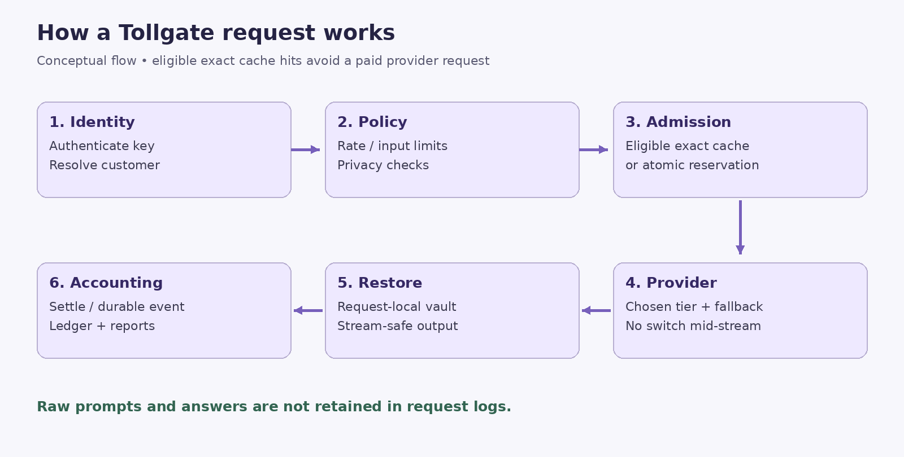{width=6.2000in height=3.1387in}

**On screen:** Animate: authenticate → resolve customer → rate admission → privacy checks → cache/budget admission → provider routing → restore → account. Annotate that the exact cache path can avoid a paid reservation.

**Narration:**

“Let’s follow a request through Tollgate. First, the gateway authenticates the application’s API key and identifies its workspace. It resolves the customer from the customer header or the request’s user field. Unknown customer identities can be created automatically using the workspace’s default plan.

Next, the gateway applies request limits and scans the supported input for sensitive information according to the customer’s effective policy. A blocked input is rejected before any provider call or abandoned cost reservation is created.

For an uncached request, Tollgate chooses an allowed tier and reserves a conservative estimate of its cost. These decisions happen atomically, so concurrent requests cannot all claim the same remaining allowance. The gateway then calls an eligible provider target, restores recognized sensitive placeholders in the response, and settles the cost.

Finally, metadata moves through the accounting system into the durable ledger and reporting views. The original prompt and answer are not retained in request logs.”

# 4. The Overview dashboard

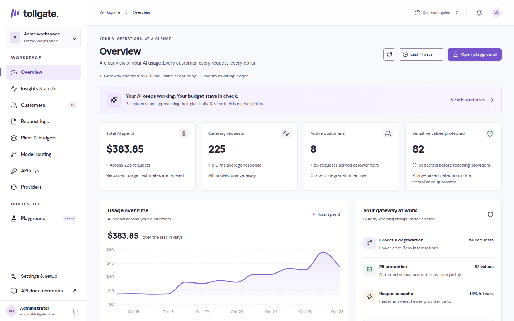{width=6.2000in height=3.8750in}

**On screen:** Open Overview. Move slowly through summary cards, the activity chart, the protection summary, and customer budget utilization.

**Narration:**

“The Overview page is the starting point for day-to-day operation. It brings spending, traffic, active customers, and input protection into one view. The chart gives context across the reporting period, while customer budget indicators help identify which customers are approaching their limits.

A budget row combines the amount used, the configured allowance, a percentage indicator, and policy information. The operator can quickly identify a customer who needs attention, open their details, and decide whether their plan or budget should change.

Tier labels need careful interpretation. A budget policy can make a customer eligible for a cheaper tier, but the actual model served is established by request history. Tollgate distinguishes policy eligibility from observed service.”

**Feature notes:** Dashboard figures reflect stored metadata and configured rates. Demonstration seed activity must remain visibly labeled as demo data. Avoid interpreting seeded activity as real customer usage or independently verified savings.

# 5. Customer management

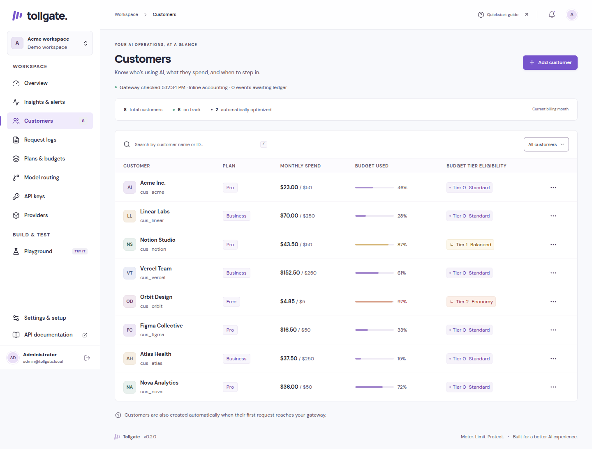{width=6.1865in height=4.7000in}

**On screen:** Search Customers by name or external ID. Open one customer. Show plan assignment, budget override, usage, and optional monthly revenue reference.

**Narration:**

“Customers are the main unit of AI usage management. Each customer has an external identity that your application can send with requests, a display name for operators, a plan, and an optional budget override.

Automatic creation makes integration easier: the first valid request for a new customer can establish their record using the workspace’s default plan. Operators can then search by name or external ID and adjust the customer’s configuration.

A customer-specific budget override allows an exception without creating a completely new plan. For example, several customers may share one standard policy while a particular customer receives a different monthly allowance.

The optional monthly revenue field provides a reference for business reporting. It lets the Insights page compare customer revenue with model cost. That comparison excludes hosting, support, salaries, and other business costs, so it should be described as AI contribution rather than complete profit.”

**Demonstration:** Use a fictional customer such as `demo_acme`. Show a persisted edit and its visible confirmation. Use synthetic information only.

# 6. Plans, budgets, thresholds, and overage

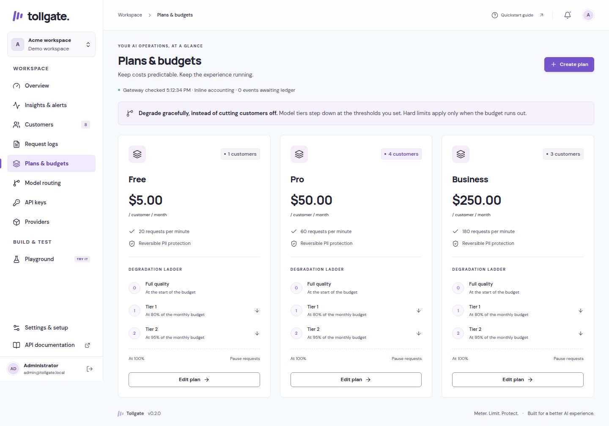{width=6.2000in height=4.3357in}

**On screen:** Open Plans & budgets and edit a sample plan. Highlight monthly allowance, requests per minute, degradation thresholds, exhaustion behavior, and privacy policy.

**Narration:**

“A plan is a reusable set of customer rules. It defines the monthly AI allowance, the customer’s request rate, the thresholds that make cheaper tiers eligible, the action at exhaustion, and the privacy settings applied to input.

For example, imagine an illustrative plan that allows normal routing until eighty percent of its allowance is used, then permits a cheaper tier, and moves further down the ladder at ninety-five percent. These are configurable examples rather than a universal recommendation. Your product’s quality requirements should determine its own thresholds and routing targets.

At exhaustion, a plan can block additional paid requests or allow bounded overage through a configured cap. Overage is a spending policy inside Tollgate; it does not automatically charge a customer’s payment method or establish commercial consent.

The budget system accounts for in-flight reservations as well as settled spend. If several requests arrive together, they must each fit within the available policy allowance before a provider call can begin. That prevents the common race where every request sees the same balance and collectively overspends it.”

**Feature notes:** Threshold percentages and tier progression are validated. Money is represented internally as integer micro-USD: one US dollar equals one million micro-USD. Customer budgets are distinct from workspace rate/concurrency controls; independent project/environment budgets are deferred.

# 7. Model aliases and automatic degradation

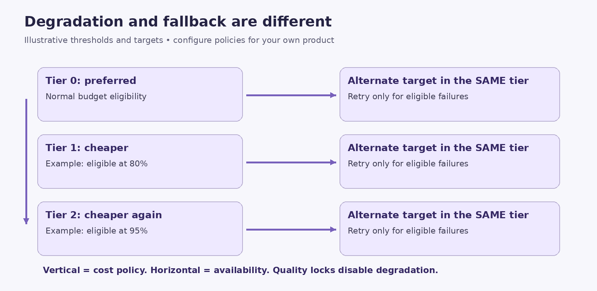{width=6.2000in height=3.0225in}

**On screen:** Open Model routing. Show an alias and its vertical tier ladder. Use mock targets in the demonstration. Highlight the quality-lock setting.

**Narration:**

“An alias gives your application a stable model name while letting operators change the models behind it. Instead of hard-coding a particular provider model throughout your product, your application can request an alias such as smart.

Each alias contains a ladder of tiers. The top tier represents the preferred configuration, and lower tiers can hold less expensive choices. Customer spending and plan rules determine which tier is eligible. This movement between tiers is called degradation: it is a cost-control decision.

Some features need consistent quality even as budgets become tight. For these aliases, operators can disable degradation. A quality lock keeps routing at the required tier, but it does not bypass budget admission. If that tier cannot be funded under the configured policy, the request can still be rejected.

This design keeps model selection centralized. The product can continue using its alias while the operator reviews cost, quality, and availability in one place.”

**Feature notes:** Tier 0 is the preferred tier in current reporting. Each tier holds an ordered list of supported, priced targets. Aliases do not provide automatic quality evaluation or guarantees that a cheaper model will produce equivalent answers.

# 8. Fallback and circuit breakers

**On screen:** Trace horizontally across two targets in one tier, then contrast that movement with the vertical budget ladder. Caption: “Degradation changes tiers. Fallback stays within a tier.”

**Narration:**

“Fallback addresses availability. Within the tier already chosen for a request, Tollgate can try another eligible target when the first attempt encounters a supported failure. This is separate from degradation, which changes tiers because of cost.

The reservation covers the most expensive possible target within the selected tier. A provider failure therefore does not silently grant permission to move outside the tier or exceed its configured reservation ceiling.

Circuit breakers help avoid repeated attempts against a target that keeps failing. A failing target can be temporarily skipped while its circuit is open; the documented default cooldown is thirty seconds.

Streaming adds a strict boundary. Before the response reaches the client, the gateway can inspect the first normalized streaming event and use an eligible fallback if needed. After streaming begins, it never switches providers mid-answer. A later failure is surfaced as an error instead of mixing answers from different models.”

**Demonstration:** If showing an outage, use a controlled mock failure. Describe it as a simulated outage, not a live-provider incident.

# 9. Sensitive-data detection and privacy modes

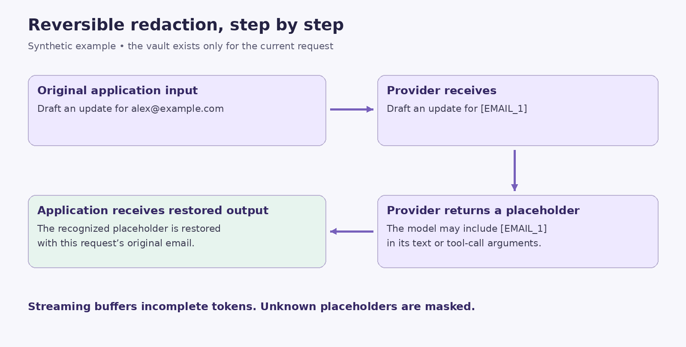{width=6.2000in height=3.1387in}

**On screen:** Enter a synthetic prompt containing `alex@example.com`. Show a redaction preview. Display a category list and the four privacy modes.

**Narration:**

“Tollgate detects supported patterns of sensitive information before sending input to a provider. The current detectors cover email addresses, phone numbers, payment cards, IBANs, Japanese My Number, Pakistani CNIC, IPv4 addresses, and common secret-key formats. Some categories use checksum validation, such as payment cards and IBANs, to reduce obvious false matches.

The policy supports four modes. Off leaves input unredacted. Mask replaces detected values without restoring their originals. Reversible replaces them with request-local placeholders and restores recognized values in the response. Block rejects input containing detected sensitive information. Plans can also block selected categories independently; payment cards are blocked by default.

In reversible mode, a provider might see an email placeholder instead of the original email address. When the provider returns that placeholder, Tollgate can replace it with the original value for the application.

These detectors are based on patterns and checksums. They do not identify every person, address, confidential business fact, or possible secret. This feature provides a defined protection layer whose coverage should be evaluated against the product’s own data.”

**Feature notes:** Scanning covers supported message text, text parts, tool schemas, and tool-call arguments. Routing identifiers and reporting tags are metadata rather than free-form prompt content. Keep secrets and personal details out of retained metadata labels.

# 10. Request-local vault and streaming restoration

**On screen:** Animate original value → placeholder → provider → placeholder → restored value. Then split `[EMAIL_1]` across several illustrated chunks and show correct reassembly.

**Narration:**

“The temporary mapping between an original value and its placeholder lives in a request-local vault. Repeated occurrences of the same value use a stable placeholder within that request. The vault is not persisted in the database, event stream, or cache.

Streaming makes restoration more demanding because a placeholder can arrive across multiple chunks. Tollgate buffers incomplete placeholder fragments until it can safely restore or mask them. Text output and each tool-call argument stream have separate restoration state.

Unknown placeholders generated by a model are masked rather than treated as permission to reveal a value. The gateway only restores mappings known to the current request.

This approach also supports privacy-safe cache reuse. A cached redacted response can be restored using the current request’s vault rather than reusing another request’s original sensitive values.”

**Feature notes:** Raw prompts, answers, provider keys, session tokens, and request vaults must not appear in logs. Privacy-off mode intentionally removes upstream redaction, while the metadata-only logging policy remains separate.

# 11. Provider support and API integration

**On screen:** Display OpenAI, Anthropic, Gemini, and Mock. Show the gateway address and a sanitized request example.

**Narration:**

“Tollgate provides an OpenAI-compatible text chat endpoint, so an existing application can often integrate by changing its base URL, using a Tollgate API key, and attaching a customer identity. Compatibility covers the implemented text, tool, and streaming behaviors; it is not a promise to support every parameter or endpoint in a provider’s full API.

OpenAI uses an OpenAI-style transport. Gemini uses Google’s supported OpenAI-compatible endpoint. Anthropic has a translation layer for system instructions, messages, function tools, tool results, usage, and streaming events. The built-in mock provider makes these workflows explorable without a paid account.

Tool support means Tollgate can transport function definitions, model-generated tool calls, and application-supplied results. The gateway does not execute arbitrary business functions for your application. Your application remains responsible for handling its tools.”

**Illustrative request:**

```json
{
  "model": "smart",
  "messages": [
    {"role": "user", "content": "Draft an update for alex@example.com"}
  ],
  "stream": true,
  "temperature": 0,
  "max_tokens": 256,
  "feature": "support_reply",
  "environment": "demo"
}
```

Send it to `POST /v1/chat/completions` with a Tollgate bearer key and `X-Tollgate-Customer: demo_acme`. The `user` field is another supported customer identity source. `GET /v1/models` lists available aliases. Configure `smart` to use mock targets for this recording; an alias name alone does not establish which provider it calls.

**Feature notes:** Current request validation allows up to 100 messages, a 256 KiB validated request size, and a `max_tokens` range of 1–8192. These are gateway constraints, not assertions about every provider’s supported context window. Input supports text and text parts, not media attachments.

# 12. Exact caching and traffic protection

**On screen:** Send a deterministic mock request twice. Show the cache indicator. Display separate labels for customer rate limit, workspace rate limit, and concurrency limit.

**Narration:**

“Exact caching reduces repeated work for matching deterministic requests. It is enabled for temperature-zero requests when privacy protection is active. Cache identity includes workspace, routing, and request information so unrelated requests do not share answers accidentally.

A matching eligible cache entry can be served without another provider call and at zero additional model cost. In the implemented cache path, an eligible hit can also remain available after the paid budget is exhausted. This is exact matching, not semantic search for approximately similar prompts.

Traffic controls protect the service from bursts and unusually heavy use. Tollgate applies atomic sliding-window rate limits at customer and workspace levels. Rate-limit rejection includes Retry-After guidance. Separate controls bound in-flight requests, request bytes, and idle upload time.

Together, these mechanisms address different pressures: rate limits control arrival frequency, concurrency limits control simultaneous work, and budgets control admitted cost.”

# 13. Precise accounting and the durable ledger

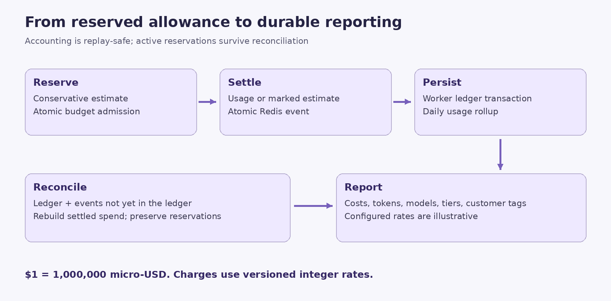{width=6.2000in height=3.0612in}

**On screen:** Show reserve → generate → settle → Redis event → worker → PostgreSQL ledger and daily rollup. Display “$1 = 1,000,000 micro-USD.”

**Narration:**

“Money calculations use integer micro-USD throughout the accounting system. Versioned input and output prices are stored as integer micro-USD per million tokens, allowing fractional per-token prices without accumulating floating-point currency errors. Final combined charges round upward to a whole micro-USD.

Before generation, the gateway reserves a conservative cost based on the allowed tier and token bounds. When reliable provider usage arrives, settlement uses that usage with configured prices. Missing or invalid usage is marked as estimated. If a stream is interrupted, accounting conservatively reflects possible provider work instead of assuming the provider charged nothing.

Redis performs reservation and settlement operations atomically. Settlement removes the reservation, updates spend, and publishes an accounting event together. A worker writes the event into PostgreSQL and updates daily usage totals in the same transaction. Replayed events do not update the ledger or rollup twice.

The PostgreSQL ledger is partitioned by month. Daily rollups support customer and workspace reporting. A reconciliation process rebuilds settled counters using durable ledger history plus events not yet represented there, while preserving active reservations.”

**Feature notes:** Reconciliation runs at startup and approximately every three minutes, using a short lease around admission/settlement state. Settlement retries and SQL recovery markers can fence admission until recovery catches up. Simultaneous unrecoverable loss of both stores cannot guarantee reconstruction of every billed outcome. Current history scanning, retention, and batching need further work for sustained high-volume deployment. Bundled rates are illustrative, not verified invoices or current provider price quotations.

# 14. Request logs and usage reporting

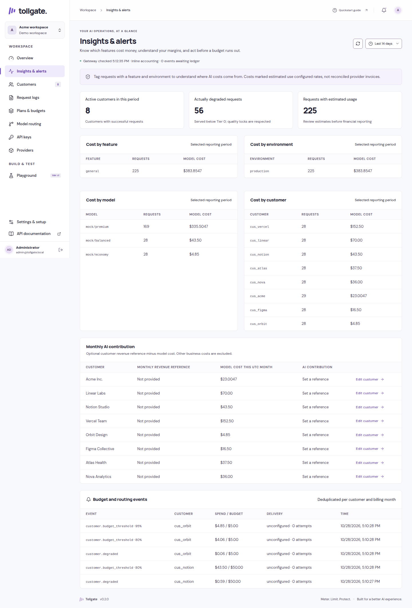{width=4.8860in height=7.2000in}

**On screen:** Filter Request logs by date and customer. Open a request’s metadata. Export the current page. Then open Insights & alerts.

**Narration:**

“Request logs provide an operational record without storing full conversations. They expose metadata such as customer identity, actual model, served tier, cost, token usage, cache status, errors, and protection counts, according to the recorded event.

Date and customer filters are applied in the database, and the table supports pagination. CSV export exports the current page, so its scope should be stated clearly when sharing results.

Insights & alerts answers business questions across the selected period. It groups costs by feature, environment, model, and customer. It also reports customers with successful activity, requests actually served below the preferred tier, and requests whose usage was estimated.

Feature and environment labels help explain where costs originate. For example, support_reply and document_summary can identify product features. These labels are reporting metadata. They do not create independent budgets, credentials, permissions, or production-versus-development isolation.

The monthly AI contribution view uses the current UTC month’s model cost and optional monthly revenue references. Its month-based scope is distinct from a freely selected reporting period, and other business costs remain excluded.”

# 15. API keys and customer allowance access

**On screen:** Create a disposable demo key. Show the once-only reveal without recording its value. Revoke it. Show the read-only usage key option.

**Narration:**

“Application API keys and administrator sessions serve different purposes. Gateway keys authenticate application traffic. Administrator sessions protect the management console and its APIs.

New keys are shown once so the operator can store them securely. The database retains a hash instead of a recoverable plaintext key, and an operator can revoke access when a key is no longer needed.

Tollgate also supports a read-only usage key bound to a customer. That key can call the usage endpoint to retrieve the customer’s budget, settled spend, reserved amount, remaining allowance, and UTC reset information. The bound identity takes precedence over a supplied customer header, and this key cannot invoke chat completions.

This creates a foundation for exposing allowance information to a customer-facing application. A complete embeddable customer usage widget remains future work.”

**Feature notes:** The read-only endpoint is `GET /v1/usage`. Never leave real keys visible in video footage, terminal history, copied screenshots, or subtitles.

# 16. Provider configuration and the Playground

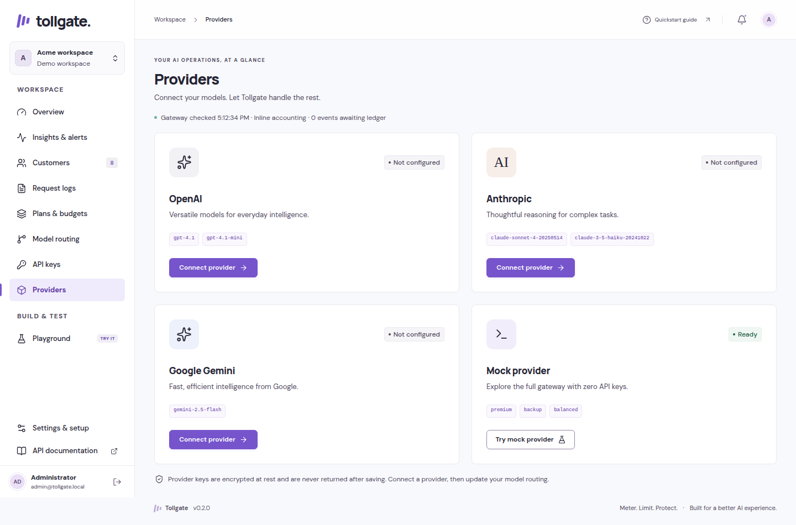{width=6.2000in height=4.0903in}

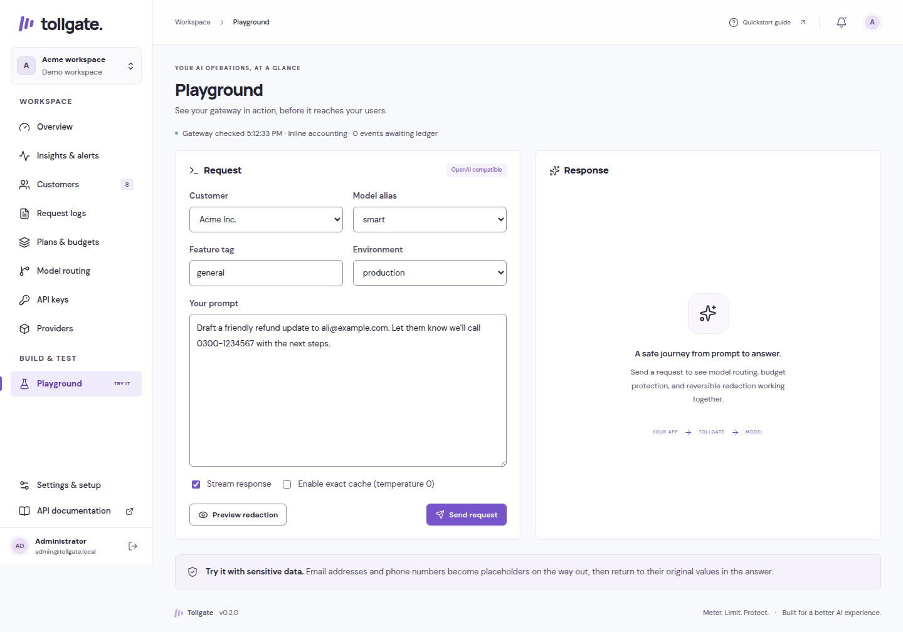{width=6.2000in height=4.3443in}

**On screen:** Open Providers, keeping credential fields concealed. Then open Playground and show customer selection, an alias, input, redaction preview, output, and response metadata.

**Narration:**

“The Providers page manages the credentials used for external services. Stored credentials are encrypted with AES-256-GCM under the deployment’s master key. Stored credentials for the selected workspace take precedence over environment fallbacks. Plaintext provider keys stay on the gateway side rather than being exposed to the browser as runtime credentials.

A configured-key indicator means a credential has been saved. It does not mean Tollgate has made a paid probe or verified access to every selected model.

The Playground combines the main gateway features into a visible test flow. Select the customer and routing alias, enter a prompt, inspect its redaction preview, and send a request. The answer appears beside the input, with the actual model, tier, and cache status available for inspection. Streaming can be stopped.

The privacy preview uses the selected workspace and customer’s effective policy, making it useful for explaining why an input would be transformed or blocked. Preview is a policy inspection step; a full request still performs gateway admission and processing.

For this walkthrough, all aliases use mock targets. Configuring real provider routing later can create real cost, so the recording should not suggest that every Playground run is free.”

# 17. Budget alerts and signed webhooks

**On screen:** Open Settings webhook configuration with secret values concealed. Show alert history in Insights. Use a diagram of an event delivered to an illustrative receiver.

**Narration:**

“Tollgate creates events for configured budget thresholds, degradation, and exhaustion. These events let an operator connect AI spending controls to external workflows such as a notification service or an internal operations tool.

An owner can configure and explicitly enable an HTTPS webhook. Events are recorded through a transactional outbox alongside accounting work, and delivery runs separately from ledger ingestion. A temporarily unavailable destination therefore does not become a reason to block ordinary accounting ingestion.

Webhook bodies are signed using an HMAC over timestamp and body information. Delivery validates public destinations, pins DNS resolution, does not follow redirects, and uses bounded retries. Delivery status and attempt counts appear in Insights & alerts.

Delivery is at least once, so receivers must deduplicate using the event ID. Budget event creation also uses customer, month, event type, and threshold information to avoid duplicate logical alerts. Notification bodies do not include prompts or answers.”

**Feature notes:** Current delivery retries are bounded to five attempts. Old unconfigured events are not automatically backfilled when a webhook is enabled. The signing secret is shown once. No external webhook delivery is required to demonstrate the configuration interface; describe any mocked delivery as simulated.

# 18. Accounts, workspaces, and safe editing

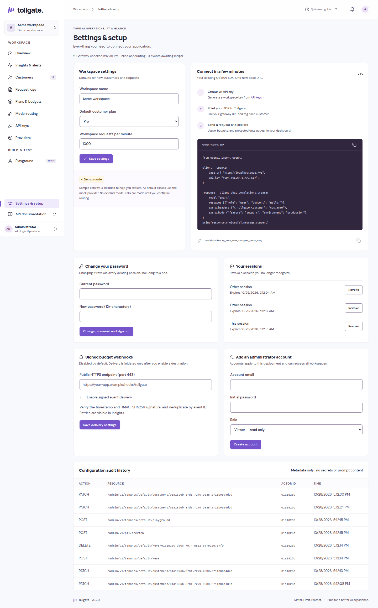{width=4.4786in height=7.2000in}

**On screen:** Show workspace selection, Settings security controls, session management, and account creation. Illustrate two operators editing the same plan and receiving a revision conflict.

**Narration:**

“Settings includes self-service security controls. Administrators can change their passwords and inspect or revoke sessions. Passwords are hashed with Argon2, and session tokens are stored as hashes. Administrative writes require authenticated sessions and CSRF protection.

Roles are owner, admin, and viewer. Viewers can inspect permitted administrative information but cannot perform ordinary writes. Owners have additional identity and security management capabilities. The console supports account creation, while role changes and disabling accounts are currently handled through the owner API.

These roles apply across the deployment. Workspace selection scopes administration and reports, but it does not create independent workspace memberships or separate tenant logins. That distinction matters when deciding which people should have access to the console.

Configuration editing uses revision checks to detect conflicting changes. If another operator updates a plan first, a stale form should produce a conflict rather than silently overwriting the newer configuration. Forms preserve full policy arrays, including rules beyond the simplest visible example.

Workspace changes reset scoped forms and cancel stale data loads. Configuration can also be exported without secrets and validated. Validation checks the proposed structure; it does not import or apply configuration.”

**Feature notes:** Administrative audit records contain metadata. Initial-owner password recovery is available through an interactive CLI command, with affected sessions revoked. Transactional configuration import and owner role-management UI are deferred.

# 19. Responsive design and everyday usability

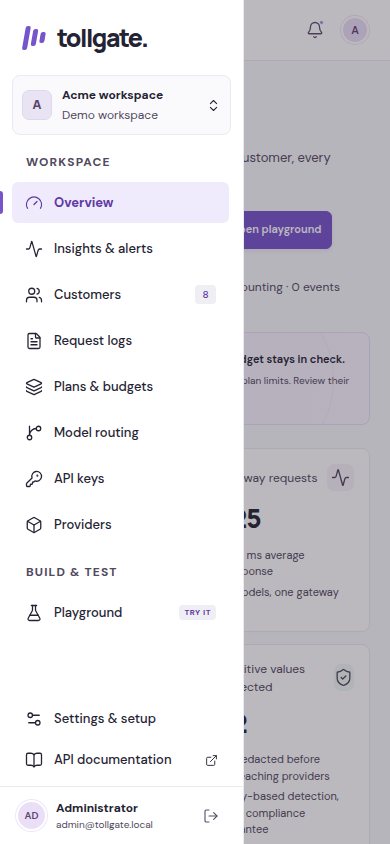{width=2.6500in height=5.7349in}

**On screen:** Show the desktop sidebar, narrow-screen drawer, a scrollable table, a keyboard-focused button, and a dialog closing with Escape.

**Narration:**

“The dashboard is organized around operator tasks. Navigation names the actual jobs: Overview, Insights and alerts, Customers, Request logs, Plans and budgets, Model routing, API keys, Providers, Playground, and Settings.

On desktop, the sidebar has a scrolling middle section and pinned account controls. On mobile, navigation becomes a drawer. Wide tables scroll inside their panels so the whole page does not need to overflow sideways.

Keyboard support includes visible focus states, labeled controls, a skip-to-content link, focus-contained dialogs, Escape handling, and a slash shortcut for supported table search. Status and error feedback stays close to the action. Budget colors are accompanied by explicit amounts, percentages, and tier labels.

The interface bundles fonts locally and supports reduced motion. These are practical accessibility features, while an independent accessibility audit and formal conformance certification remain separate work.”

# 20. Deployment, operations, and maintenance

**On screen:** Show a diagram with Next.js dashboard, FastAPI gateway, Redis, PostgreSQL, and worker. Display the four default Tollgate ports.

**Narration:**

“Tollgate has two main operating modes. The local demo uses SQLite and a single-process in-memory fast path. It is useful for exploration without Docker or paid credentials. That memory mode is not suitable for sharing state across multiple gateway workers.

The Docker Compose setup uses PostgreSQL and Redis alongside the gateway, dashboard, migration job, and worker. The dashboard is built with Next.js; the gateway and worker use Python and FastAPI-related infrastructure. The browser reaches administrative APIs through the dashboard’s same-origin proxy.

The default ports are 3187 for the dashboard, 8187 for the gateway, 55487 for PostgreSQL, and 63987 for Redis. Compose uses the tollgate project name, its own network and volumes, and loopback publishing for the database services. Port checks and overrides let it coexist with other projects.

Operational endpoints expose process health, dependency readiness, and basic Prometheus request and error counters. Settings also surfaces readiness and worker delivery information. An optional observability overlay adds Prometheus and Grafana; detailed distributed tracing remains future work.

Maintenance tools cover serving, migration, seeding, key generation, password recovery, offline configuration validation, and encrypted-secret rotation. Rotation is a maintenance operation that rewrites encrypted records transactionally; changing only the environment master key is not a substitute.

Recovery requires coordinated backups of PostgreSQL and Redis persistence, along with secure access to the master key needed to decrypt credentials.”

**Feature notes:** Images run as non-root. Redis AOF persistence is configured in the supplied Compose deployment. Database migrations are serialized and monthly ledger partitions are created as needed. Do not show a destructive reset as part of ordinary setup footage.

# 21. Testing evidence and current limits

**On screen:** Show repository validation records with their recorded dates. Separate “existing recorded verification” from “future verification.”

**Narration:**

“The repository includes backend unit, API, provider-adapter, and property tests, infrastructure tests against Redis and PostgreSQL, and Playwright browser workflows. Coverage includes concurrent budget admission, placeholder restoration across streaming boundaries, key revocation, administrative security, cache isolation, worker replay, and accounting recovery.

Recorded validation for the existing release includes seventy-nine infrastructure-backed tests, seventy passing memory-mode tests with nine infrastructure skips, eleven browser tests, static checks, and a production dashboard build. These are historical repository results from the documented release work, not new test runs performed for this script.

Provider behavior was exercised with mocks and recorded transports. That does not establish current live model availability, current provider prices, production capacity, or independent security certification.

Before paid production traffic, the project still calls for live model and price review, explicitly authorized capped provider tests, independent security and capacity review, realistic load and soak testing, and rehearsed backup and recovery procedures. Current reconciliation scans history and retained events, so retention, checkpoints, and batching remain important scale work.”

# 22. Roadmap: what is outside this release

**On screen:** Show a clearly labeled “Planned / deferred” slide, using the following groups.

**Narration:**

“The roadmap extends the existing gateway without treating planned features as completed. Team and isolation work includes workspace-specific memberships, independent project or environment budgets and credentials, and a richer owner role-management interface.

Business workflow work includes configuration import, customer usage widgets, upgrade and proration workflows, explicit commercial overage consent, and per-feature quality evaluation.

Optional integrations include SSO, Stripe synchronization, AWS KMS, more advanced name and address recognition through Presidio, tracing, Helm packaging, semantic caching, and embeddings or media support.

Public hosting, domain purchases, and image publication are separate operator activities. The presence of deployment files does not mean the application has been publicly launched.”

# 23. Closing narration

**On screen:** Return to Overview, then show the request-flow diagram and a final title card.

**Narration:**

“Tollgate brings customer identity, spending policy, provider routing, input protection, and usage reporting into the path of an AI request.

For developers, it offers an OpenAI-compatible integration point with text streaming and function-tool transport. For operators, it provides customers, plans, budgets, routing, keys, providers, reports, alerts, and security controls in one console. Underneath, atomic reservations and a durable accounting pipeline help keep admitted cost and recorded usage connected.

The current release is a working self-hosted foundation with a local mock mode for exploration and a PostgreSQL-and-Redis deployment path. Its production review and roadmap remain explicit. To explore it, start with the labeled demo, follow a customer request through the Playground, and see how policy, protection, routing, and accounting work together.”

# 24. Recommended recording sequence

Use this order for a coherent end-to-end demonstration. These are recording instructions, not claims that footage has already been captured.

1. Start the labeled demo and show the workspace selector and Overview.
2. Open a fictional customer and explain its external ID, plan, and allowance.
3. Inspect the plan’s budget, privacy rules, and degradation thresholds.
4. Open the customer’s alias and explain vertical tiers and horizontal fallback.
5. Use the Playground with mock routing and a synthetic email address.
6. Show the effective redaction preview, then stream a response and explain restoration.
7. Repeat an identical temperature-zero request to illustrate eligible cache behavior.
8. Open Request logs, apply date/customer filters, and inspect metadata without conversation text.
9. Open Insights to compare feature, model, customer, and environment cost.
10. Demonstrate the once-shown key workflow using a disposable key, conceal its value, and revoke it.
11. Explain customer-bound usage keys and their read-only allowance endpoint.
12. Show alert delivery metadata and webhook configuration without contacting an external destination.
13. Show password/session controls and explain deployment-wide roles and workspace boundaries.
14. Switch to mobile layout, demonstrate navigation, and return to the architecture slide.
15. Close with implemented scope, historical validation, and the deferred roadmap.

For degradation and fallback footage, use controlled mock scenarios and captions identifying them as simulations. Do not present a seeded chart, fabricated outage, or illustrative price as a measured live result.

# 25. Ready-to-use video title and publishing description

**Suggested title:** Tollgate Full Walkthrough: Customer AI Budgets, Smart Routing, Privacy Protection, and Usage Analytics

**Description:**

“Tollgate is a self-hosted, OpenAI-compatible AI gateway for SaaS applications. It connects model usage to customers, applies plan-based budgets and request limits, routes eligible traffic to cheaper tiers as spending increases, and supports provider fallback within the selected tier.

This full walkthrough explores the dashboard and gateway: customer management, plans and overage controls, quality locks, model aliases, OpenAI/Anthropic/Gemini adapters, mock-provider testing, reversible sensitive-data redaction, streaming restoration, exact caching, precise cost accounting, request logs, feature-level reporting, customer usage keys, signed webhooks, administrator sessions and roles, workspace settings, and Docker operations.

The demonstration is intended to use labeled mock traffic. Bundled pricing is illustrative, administrator roles are deployment-wide, and environment tags are reporting metadata. Live-provider verification, independent security and capacity review, and several team and integration features remain outside the current release’s completed scope.”

**Suggested chapter labels:** Introduction; Request flow; Overview; Customers; Plans and budgets; Model routing; Fallback; Privacy modes; Streaming restoration; Provider integration; Cache and traffic limits; Accounting; Logs and Insights; API keys; Playground; Alerts; Security and workspaces; Mobile interface; Operations; Validation; Roadmap.

# 26. Terminology for presenters

| Term | Meaning in Tollgate |
|---|---|
| Workspace / tenant | Administrative scope for application configuration and usage; not separate dashboard membership. |
| Customer | Application-level identity to which a plan, allowance, and usage are attached. |
| Alias | Stable name requested by an application, backed by configured model tiers. |
| Tier | Ordered quality/cost routing level; Tier 0 is the preferred level. |
| Degradation | Budget-driven movement to another permitted tier. |
| Fallback | Availability-driven attempt at another eligible target within the selected tier. |
| Quality lock | Disables degradation for an alias while retaining budget checks. |
| Reservation | Temporary allowance committed before a paid provider request. |
| Settlement | Finalizes accounting using provider usage or a marked estimate. |
| Vault | Request-local mapping from sensitive values to placeholders. |
| Exact cache | Reuse of matching deterministic privacy-enabled requests; not semantic matching. |
| Micro-USD | Integer currency unit equal to one millionth of a US dollar. |
| AI contribution | Revenue reference minus model cost; excludes other business costs. |
| Usage key | Customer-bound read-only access to allowance information; cannot call chat. |

# 27. Source and accuracy notes

This document is grounded in the repository’s REQUIREMENTS.md, ARCHITECTURE.md, DESIGN.md, MEMORY.md, README.md, ROADMAP.md, TASKS.md, docs/configuration.md, docs/operations.md, and docs/validation.md, together with gateway schemas, routes, accounting/routing orchestration, account-security code, and dashboard views.

Where older documentation describes earlier review findings, the later 0.2 implementation and validation notes establish the scope described here. The included screenshots are historical demo captures in docs/audits/2026-10-28-prs. Four explanatory diagrams were added for this illustrated edition. No application code, runtime configuration, provider credential, service, or database was changed to prepare this document. No new performance benchmark, paid model call, external webhook delivery, deployment, or security audit is claimed.
